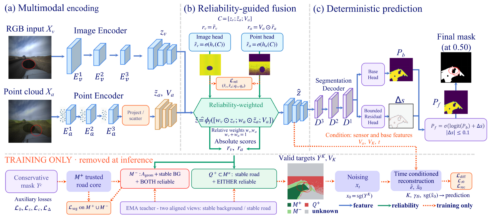
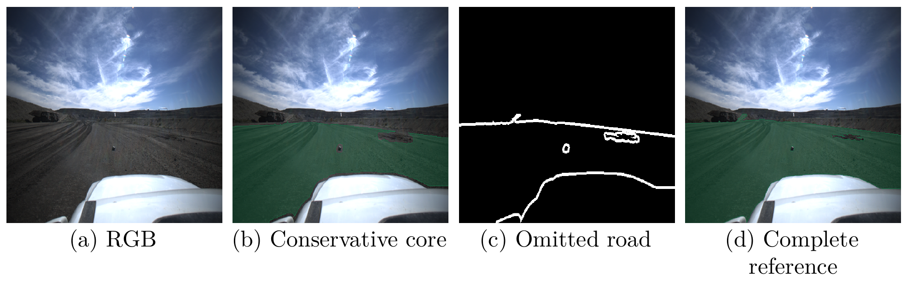
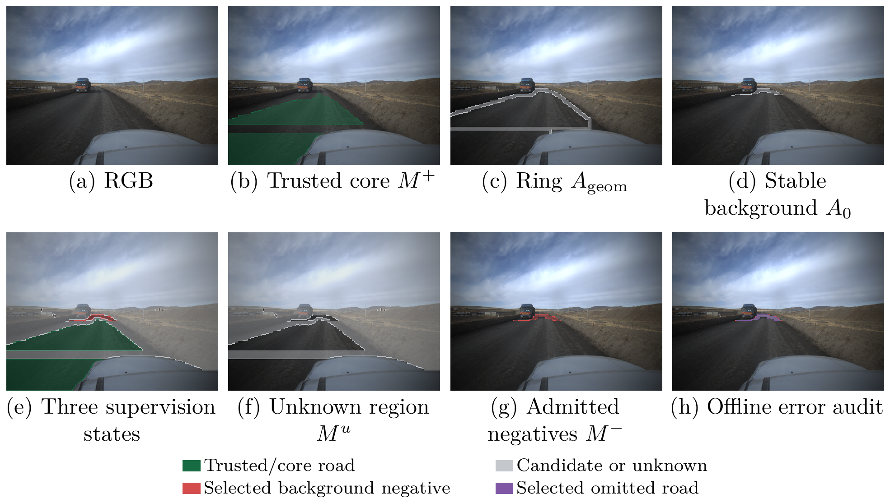
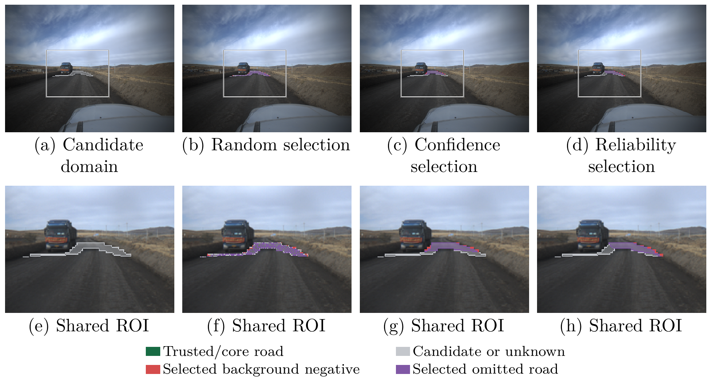
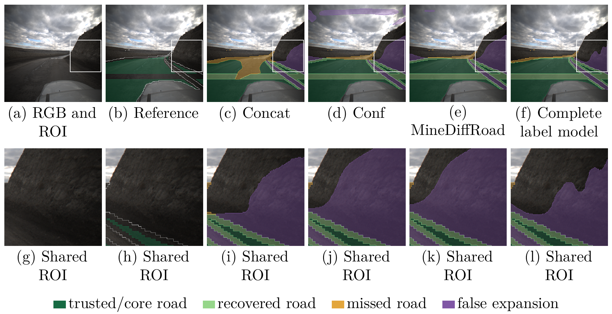
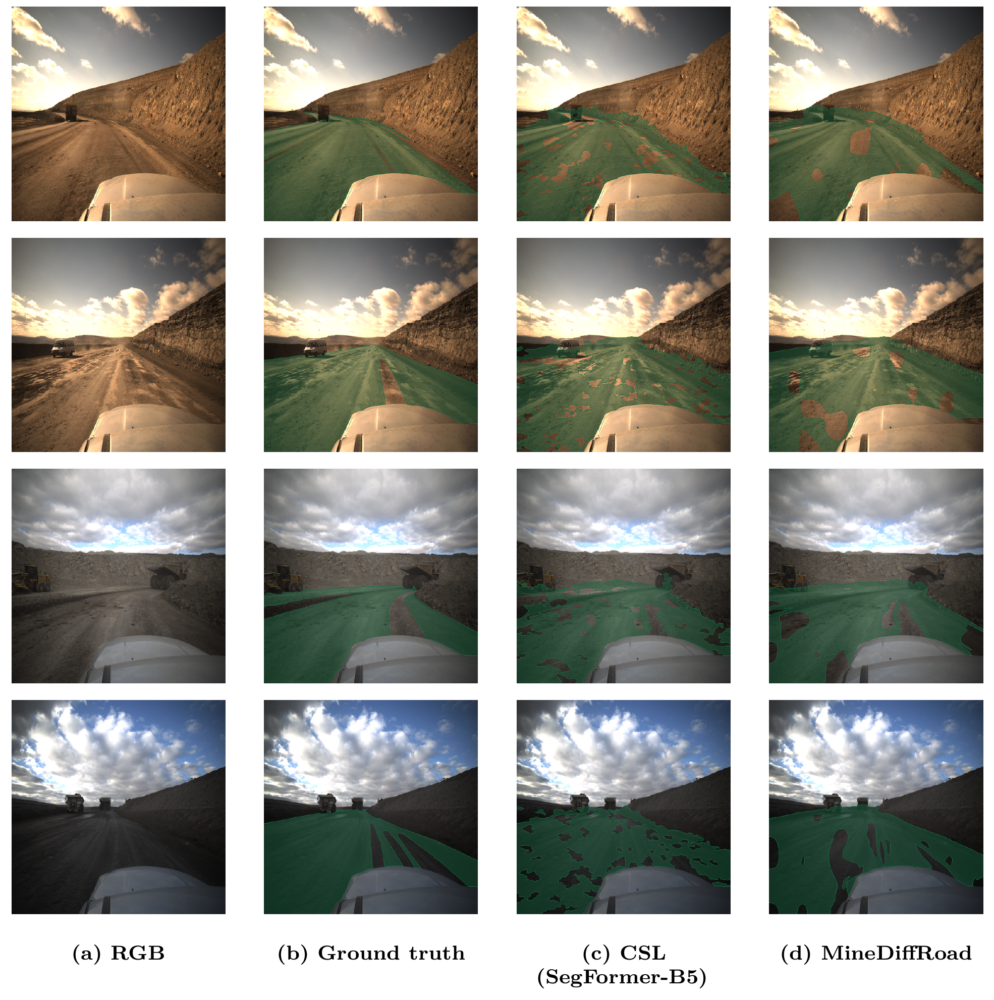
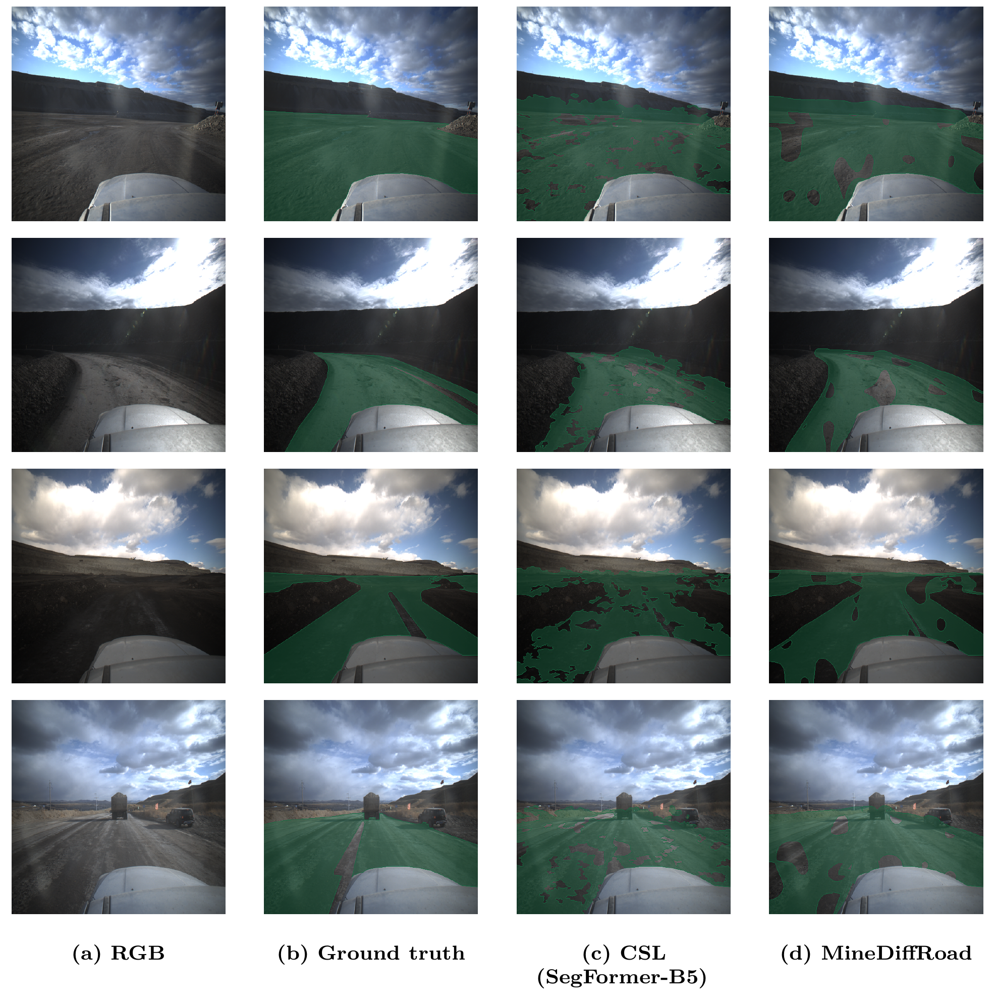
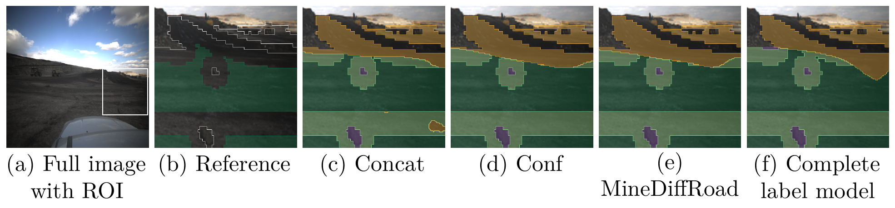

# MineDiffRoad

### Supervision Admission Guided by Reliability for Mine Road Segmentation with Conservative Annotations

**Recover omitted road from conservative annotations using RGB–LiDAR observation reliability.**

[中文说明](README.zh-CN.md) · [Method](#method) · [Paper results](#paper-results) · [Quick start](#quick-start) · [Full tables](docs/PAPER_RESULTS.md) · [Figure gallery](docs/FIGURES.md)



*Figure 2 from the paper. Reconstruction and teacher-based supervision selection are used during training. Deployment retains the encoders, fusion, base prediction, and bounded residual refinement in one forward pass. Click any figure to view its full resolution.*

## Overview

Conservative road annotations identify confirmed road but leave both background and omitted road unlabeled. Treating every unlabeled pixel as background suppresses real road; ignoring all of them removes useful negative evidence.

MineDiffRoad uses local observation quality to decide **where a training target is justified**, then recovers road from supported positive candidates. Observation reliability and semantic confidence play different roles: a stable prediction is not necessarily supported by a clear image or sufficient LiDAR returns.

- **Selective negative admission:** stable background predictions require reliable observations from both modalities.
- **Asymmetric positive recovery:** stable road candidates can be supported by either modality.
- **Valid-region reconstruction:** noise-conditioned reconstruction learns from trusted labels and soft candidates while excluding unresolved pixels.
- **Bounded refinement and direct inference:** residual corrections are bounded, and the reconstruction branch is removed after training.



*Figure 1. Complete references illustrate missing road and support evaluation; they are not training targets for the conservative-label method.*

## Method

### Reliability guides both features and supervision

RGB and LiDAR features are aligned on a 128 × 128 fusion grid through calibrated projection. Reliability heads learn image and point observation quality from controlled degradation proxies. Relative reliability weights combine the features, while absolute reliability scores control supervision admission. Missing point observations have zero effective point reliability.

### Three supervision states and soft recovery candidates

| State | Admission rule after warm-up | Target |
|---|---|---|
| Trusted positive $M^+$ | Annotated conservative road core | 1 |
| Admitted negative $M^-$ | Geometric ring; both teacher road probabilities < 0.10; both reliability scores > 0.50 | 0 |
| Positive candidate $Q^+$ | Unknown pixel; both teacher road probabilities > 0.90; view difference < 0.05; at least one reliability score > 0.50 | Detached mean teacher probability |
| Remaining unknown | No admitted target | Excluded from target-based losses |

The negative search ring is $A_{\mathrm{geom}}=[\mathcal D_{25}(M^+)\setminus\mathcal D_{11}(M^+)]\cap\{Y^c=0\}\cap\Omega$. Here, 25 and 11 are **dilation kernel widths**, not radii, on the 512 × 512 image grid.

The valid target set is $K=M^+\cup M^-\cup Q^+$. Values outside $K$ are filled with 0.5 for reconstruction input but do not become training labels. Boundary and skeleton losses also propagate target validity.



*Figure 3. Complete references are used only for the offline selection-error audit. The code uses the supplied valid mask to define the image domain.*

### Training-only reconstruction and bounded refinement

One diffusion time is sampled per training step. The reconstruction head predicts noise and reconstructs the valid soft target map using sensor and base features as context. Its detached reconstruction supervises segmentation on the same valid set.

The retained refinement head updates the base logit difference with a bounded correction:

$$
s_f=s_b+\alpha(1-|2P_b-1|)\tanh(h(F_c)),\qquad P_f=\sigma(s_f),\qquad \alpha=0.1.
$$

The instantaneous logit correction is at most 0.1, and the probability correction is at most 0.025. This bound applies to one forward correction, not cumulative training influence. At inference, the reconstruction branch and EMA teacher are removed; no iterative reverse-diffusion sampling is required.

## Paper results

Results below are taken from the accompanying paper. All metrics are percentages unless stated otherwise; ↑ means higher is better and ↓ means lower is better. The main protocol reports five seeds (0–4), pooling test pixel counts within each seed before averaging IoU across seeds.

| Metric | Meaning |
|---|---|
| IoU ↑ | Road intersection over union |
| MR ↑ | Recall of omitted road relative to a frozen evaluation core |
| EP ↑ | Precision of predicted expansion outside that core |
| FNS ↓ | Fraction of selected negatives that are actually omitted road |
| BR ↑ | Fraction of eligible true background retained as negative supervision |

MR and EP are averaged over valid frames, excluding undefined denominators. Read them together: larger recovered extent should also retain accurate expansion.

### Overall comparison — Table 1

| Method | IoU ↑ | MR ↑ | EP ↑ |
|---|---:|---:|---:|
| Partial BCE, trusted positives only | 60.84 | 55.27 | 41.63 |
| Stable background + hard teacher targets | 62.33 | 64.18 | 46.72 |
| nnPU adaptation | 61.92 | 47.36 | 48.51 |
| GCE robust loss | 62.16 | 49.83 | 48.92 |
| SCE robust loss | 62.51 | 51.24 | 49.38 |
| Mean Teacher, multimodal adaptation | 63.47 | 50.65 | 49.84 |
| UniMatch, multimodal adaptation | 64.21 | 54.38 | 50.61 |
| CorrMatch, multimodal adaptation | 64.79 | 57.26 | 51.17 |
| UniMatch V2, protocol matched | 65.62 | 60.48 | 51.83 |
| CSL adaptive selection | 65.94 | 63.56 | 52.42 |
| UniMatch V2, DINOv2-Base image backbone † | 66.52 | 66.31 | 52.87 |
| CSL, SegFormer-B5 image backbone † | 66.73 | 67.84 | 53.16 |
| Concat, matched architecture | 63.58 | 71.42 | 46.93 |
| Conf, matched architecture | 64.94 | 73.68 | 50.87 |
| Reliability selection only | 67.61 | 76.84 | 53.73 |
| **MineDiffRoad** | **68.57** | **79.13** | **55.12** |

† Stronger image-backbone references use LitePT-S and late fusion; their image encoder capacity differs. Bold marks the best values among the conservative-label methods shown. The separately supervised complete-label reference reports **69.21 / 80.42 / 55.79** (IoU / MR / EP) with a different auxiliary update schedule.

The paper reports **68.57 ± 0.27% IoU**, compared with **64.94 ± 0.19%** for the matched Conf model: **+3.63 percentage points**, with a paired 95% interval of [3.44, 3.82] points.

### Where negatives are placed — Table 2(a)

The controlled replay fixes teacher outputs, candidate domains, positive candidates, and the number of selected negatives. Every selector uses a **60% negative quota**.

| Negative ranking | FNS ↓ | BR ↑ | IoU ↑ | MR ↑ | EP ↑ |
|---|---:|---:|---:|---:|---:|
| Random | 4.62 | 60.03 | 65.44 | 70.83 | 47.92 |
| Confidence | 3.81 | 60.52 | 66.14 | 72.61 | 49.84 |
| MC uncertainty, eight passes | 3.18 | 60.93 | 66.91 | 74.83 | 51.42 |
| **Reliability** | **2.91** | **61.08** | **68.76** | **78.21** | **54.13** |

Reliability ranking improves IoU by **2.62 points** over confidence ranking under this control. The **68.76% replay result** and the **68.57% online result** use different protocols. The factorial comparison reports a 2.81-point selection effect and a 1.03-point fusion effect; see [Table 2(b)](docs/PAPER_RESULTS.md#table-2b-fusion-and-selection).



*Figure 7. Each selector chooses 409 of 682 candidates in this illustration. Purple identifies omitted road selected as negative, using an offline reference audit.*

### Recovery ablation — Table 3(a)

Teacher outputs, candidates, auxiliary steps, and capacity are fixed in this comparison.

| Recovery rule | IoU ↑ | EP ↑ |
|---|---:|---:|
| Direct supervision with hard candidates | 67.09 | 50.67 |
| Direct supervision with soft candidates | 67.37 | 52.27 |
| **Reconstruction on the valid set + bounded residual** | **68.76** | **54.13** |
| Reconstruction on the valid set, residual unbounded | 67.59 | 51.47 |

### Other evaluation settings — Table 4

| Evaluation setting | MineDiffRoad IoU ↑ | Reference | Reference IoU ↑ | Difference |
|---|---:|---|---:|---:|
| Human conservative masks | 67.57 | Concat | 65.82 | +1.75 pp |
| Mine-B, no adaptation | 63.27 | CSL | 62.13 | +1.14 pp |
| RELLIS-3D surface task | 63.49 | CSL | 62.41 | +1.08 pp |
| Natural degradation mean | 64.05 | Conf | 60.72 | +3.33 pp |

Human masks come from a separate batch in the principal mining area. Mine-B evaluates frozen SegMine models without adaptation. RELLIS-3D models are trained independently, with asphalt, concrete, dirt, mud, and grass mapped to the foreground surface class. Natural degradation averages seven conditions equally.

[Full paper tables](docs/PAPER_RESULTS.md) include feature-feedback controls, noise/time-conditioning ablations, connectivity, and resource costs. CSV versions are available in [docs/results/](docs/results/).

## Qualitative examples



*Figure 4. Deep green: trusted or correctly predicted road; light green: recovered road; amber: missed road; purple: false expansion. The paper uses seed 0, validation-selected checkpoints, threshold 0.50, and identical postprocessing.*

<details>
<summary><b>Comparison with CSL using SegFormer-B5 — samples 1–8</b></summary>



*Figure 5. Columns: RGB / complete reference / CSL (SegFormer-B5) / MineDiffRoad. Deep green denotes road.*



*Figure 6. The same column order and display convention are used for four additional scenes.*

</details>

### Failure case



*Figure 8. Terrain that resembles road can cause false expansion. Observation reliability does not resolve every semantic ambiguity. Colors follow Figure 4.*

The paper also identifies substantial errors on the broader endpoint-connection audit: raw conditional endpoint FCR is 99.06%. Optional graph pruning reduces this at a coverage and continuity cost. See [connectivity results and definitions](docs/PAPER_RESULTS.md#table-5-connectivity).

## Quick start

### 1. Install

Use Linux, Python 3.10 or later, and a CUDA-capable NVIDIA GPU for the LitePT-S backbone. Run these commands from the repository root. Install PyTorch appropriate for your driver and CUDA environment before the remaining dependencies.

```bash
python -m venv .venv
source .venv/bin/activate
python -m pip install --upgrade pip
# Install your compatible PyTorch build here before continuing.
python -m pip install -r requirements-cuda.txt
python -m pip install -e . --no-deps
python -m minediffroad --help
```

[requirements-tested.txt](requirements-tested.txt) records the validation environment. The CUDA requirements pin `spconv-cu124` and `cumm-cu124`; select compatible builds if your environment differs and avoid installing multiple spconv variants together. CPU supports data/supervision/loss/interface checks; training and inference use the real CUDA point backbone.

### 2. Prepare paired data

Datasets and pretrained weights are prepared separately. Create a JSONL manifest following [the data format](docs/DATA_FORMAT.md) and [the manifest example](examples/manifest.example.jsonl). Replace example paths with real data paths.

| Input | Required format |
|---|---|
| RGB | PNG/JPEG |
| LiDAR | `float32` N × 4 `.npy`: `[x, y, z, intensity]`; coordinates in metres; intensity in [0, 1] |
| Calibration | JSON with a 3 × 3 `K` and 4 × 4 `T_lidar_to_camera` |
| Training annotation | Binary conservative `core` mask; training records must not contain `reference` |
| Evaluation annotation | Independent complete `reference` mask for validation/test |
| Split control | Unique frame `id`, explicit `group` and `split`; each group belongs to one split |

```bash
python -m minediffroad verify-data --manifest /absolute/path/manifest.jsonl

# Optional: cache farthest-point sampling before training.
python -m minediffroad prepare-fps \
  --manifest /absolute/path/manifest.jsonl \
  --output /absolute/path/fps_cache_new --num-points 16384 --device cuda
```

FPS writes indices, metadata, and a new `manifest.jsonl`; original point clouds remain unchanged. Use the new manifest in subsequent commands. The manifest example provides the schema, not actual sample data.

The paper's SegMine working subset uses 8,820 / 1,260 / 2,520 frames across acquisition groups 01–08 / 09–10 / 11–12. Keep acquisition groups separated when preparing train/validation/test manifests; exact frame lists must come from the experiment data, not frame counts alone.

### 3. Configure and train

Copy [configs/paper.yaml](configs/paper.yaml) to `configs/my_run.yaml`. Set `imagenet_checkpoint` to a MiT-B0 ImageNet checkpoint from the [NVIDIA SegFormer repository](https://github.com/NVlabs/SegFormer), and optionally set `imagenet_sha256`. The loader checks keys, shapes, and the file hash. Weights are not downloaded automatically. `allow_random_image_init: true` is for explicitly chosen random-initialization experiments.

| Setting | Provided configuration |
|---|---|
| RGB / point budget | 512 × 512 / 16,384 points |
| Training | 80 epochs; batch size 8; AdamW; cosine decay |
| Warm-up | Epochs 1–10 use geometric ring negatives |
| Teacher | Initialized at epoch 11; EMA coefficient 0.99 |
| Reconstruction | 1,000 noise levels; cosine offset 0.008 |
| Residual bound | 0.1 in logit space |
| Seed | 0 by default; configurable |
| Mixed precision | Enabled; sparse point branch remains FP32 |

The supplied `learning_rate: 6e-5` and `weight_decay: 0.01` form one of the manuscript's search candidates. Select hyperparameters on validation data and record the configuration used. Implementation choices, including the MiT-B0 stride-4 first-stage interface, are described in [IMPLEMENTATION_NOTES.md](docs/IMPLEMENTATION_NOTES.md).

```bash
cp configs/paper.yaml configs/my_run.yaml
# Edit configs/my_run.yaml, especially imagenet_checkpoint, before training.
python -m minediffroad train \
  --config configs/my_run.yaml \
  --manifest /absolute/path/fps_cache_new/manifest.jsonl \
  --output runs/seed0_new
```

Training creates `config.yaml`, `environment.json`, `train.log`, `steps.csv`, `epoch_XXX.pt`, and `checkpoint_index.json`. With a validation split, each `validation_XXX/` contains `metrics.json` and `per_image.csv`. Read `checkpoint_index.json` to identify the validation-selected epoch; the code saves epoch files rather than `best.pt`.

For limited GPU memory, reduce `batch_size`; `empty_cache_each_epoch: true` is also available. Record input-resolution or point-budget changes when comparing methods. Resume with an unchanged configuration and manifest, using a fresh output directory:

```bash
python -m minediffroad train \
  --config runs/seed0_new/config.yaml \
  --manifest /absolute/path/fps_cache_new/manifest.jsonl \
  --resume runs/seed0_new/epoch_040.pt \
  --output runs/seed0_resume_new
```

### 4. Evaluate, predict, and export

The epoch numbers below illustrate usage. Replace them with the checkpoint selected on validation data, never on the test set.

```bash
python -m minediffroad evaluate \
  --checkpoint runs/seed0_new/epoch_080.pt \
  --manifest /absolute/path/manifest.jsonl --split test \
  --output runs/evaluation_new --device cuda

python -m minediffroad predict \
  --checkpoint runs/seed0_new/epoch_080.pt \
  --manifest /absolute/path/manifest.jsonl --split test \
  --output runs/predictions_new --device cuda --save-probabilities

python -m minediffroad export \
  --checkpoint runs/seed0_new/epoch_080.pt \
  --output checkpoints/deployment_new.pt
```

| Command | Generated output |
|---|---|
| `evaluate` | `per_image.csv` and `metrics.json`; pooled global metrics and per-image means are separate |
| `predict` | Binary PNG masks, optional probability `.npy` files, and `index.json` mapping frame IDs to hashed filenames |
| `export` | PyTorch deployment weights for the segmentation path; usable with `predict --checkpoint` |

The evaluator reports Road IoU, two-class mIoU, Dice, Precision, Recall, Accuracy, and Boundary F1. Paper-specific MR/EP, FNS/BR, connectivity audits, and frozen replay require their corresponding evaluation records and procedures; they are not outputs of this CLI. Default postprocessing uses threshold 0.50 and removes 8-connected components smaller than 50 pixels. Predictions use the configured input resolution. For unlabeled inference, use `--split predict` with sensor/calibration records. Export produces a PyTorch checkpoint.

### 5. Software checks

```bash
# CPU checks with synthetic inputs.
python -m unittest discover -s tests -v

# Optional real-backbone CUDA and training/checkpoint round-trip checks.
MINEDIFFROAD_TEST_CUDA=1 MINEDIFFROAD_TEST_ROUNDTRIP=1 \
  python -m unittest discover -s tests -v
```

See [SOFTWARE_VALIDATION.md](docs/SOFTWARE_VALIDATION.md) for the recorded environment and test coverage.

## Repository map

```text
MineDiffRoad/
├── README.md / README.zh-CN.md
├── configs/paper.yaml
├── minediffroad/
│   ├── backbones.py       # Image and LitePT-S adapters
│   ├── geometry.py        # FPS, projection, depth filtering, aggregation
│   ├── model.py           # Reliability, fusion, reconstruction, refinement, EMA
│   ├── supervision.py     # Supervision states and selection
│   ├── losses.py          # Valid-region losses
│   ├── data.py            # Manifest, aligned views, degradation proxies
│   ├── engine.py          # Training, resume, evaluation, prediction
│   └── metrics.py
├── docs/                  # Data format, method mapping, tables, figure provenance
│   ├── figures/           # Eight figures from the paper
│   └── results/           # Paper tables in CSV format
├── examples/              # Manifest and calibration schema
├── tests/
├── scripts/package_source.py
└── third_party/           # LitePT provenance and license
```

## License and acknowledgments

The source code uses the [MIT license](LICENSE). Vendored LitePT files retain their [upstream attribution and license](third_party/README.md). Image-backbone architecture and checkpoint attribution are documented there as well. Paper figures and table sources are listed in [the figure gallery](docs/FIGURES.md) and [the provenance manifest](docs/ASSET_PROVENANCE.json). Underlying datasets and externally distributed weights retain their own terms.
